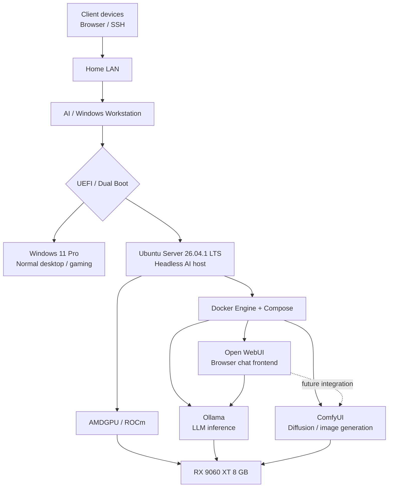

# Local AI Workstation

## System Architecture & Technical Design

Dual-boot Windows / Ubuntu headless AI host  
AMD ROCm + containerized LLM and diffusion services

Architecture baseline: Version 1.0  
Validated against vendor documentation as of 03 October 2026

| Primary AI accelerator | AMD Radeon RX 9060 XT — 8 GB VRAM                            |
|------------------------|--------------------------------------------------------------|
| Host CPU / memory      | AMD Ryzen 5 9600X / 32 GB DDR5                               |
| AI operating system    | Ubuntu Server 26.04.1 LTS                                    |
| Runtime architecture   | AMDGPU/ROCm → Docker Compose → Ollama / ComfyUI / Open WebUI |
| Access model           | Headless; browser and SSH over the home LAN                  |

# Document Control

Purpose: define the agreed architecture for a dual-purpose desktop that operates as a normal Windows 11 Pro workstation or, when booted into Linux, as a headless local generative-AI server. This document records the hardware allocation, boot/storage topology, GPU software stack, container/service boundaries, network exposure, workload constraints, and implementation decisions.

| **Item**             | **Value**                                       | **Status**          |
|----------------------|-------------------------------------------------|---------------------|
| Architecture version | 1.0                                             | Baseline            |
| Validation date      | 03 Oct 2026                                     | Current             |
| Primary use          | Occasional local AI experimentation / inference | Agreed              |
| Normal desktop use   | Windows 11 Pro                                  | Agreed              |
| Coral TPU            | Deferred to a later phase                       | Out of scope for V1 |

# Contents

> 1\. Executive Summary
>
> 2\. Design Objectives and Boundaries
>
> 3\. Physical Hardware Architecture
>
> 4\. Storage and Dual-Boot Design
>
> 5\. Firmware / UEFI Requirements
>
> 6\. Ubuntu and GPU Compute Stack
>
> 7\. Container and Application Services
>
> 8\. Network and Remote-Access Architecture
>
> 9\. Storage Persistence and Data Layout
>
> 10\. Workload / VRAM Management
>
> 11\. Security, Maintenance, and Recovery
>
> 12\. Validation Matrix
>
> 13\. Implementation Sequence
>
> 14\. Open Decisions and Future Expansion
>
> Appendix A. Model Sizing and Quantization
>
> Appendix B. Authoritative References

# 1. Executive Summary

**The system is a dual-boot desktop with physically separate NVMe drives for Windows and Ubuntu.** Windows 11 Pro remains the day-to-day desktop and gaming environment. Ubuntu Server 26.04.1 LTS is the dedicated headless AI environment. When booted into Ubuntu, the RX 9060 XT is used as the primary GPU compute device through AMDGPU/ROCm; Docker Engine and Compose host the AI services.

The V1 service stack is intentionally modular: Ollama provides local LLM inference; Open WebUI provides the primary browser-based chat interface; ComfyUI provides image-generation workflows. The services share the same 8 GB GPU, but heavy workloads are expected to run sequentially rather than concurrently. Persistent models, configuration, conversation data, workflows, and outputs are stored outside disposable containers under a dedicated Linux data tree.

The architecture is technically supportable with current vendor documentation: the motherboard provides four M.2 slots and isolates the primary GPU from M.2 lane sharing; Ubuntu 26.04 LTS is supported through 2031; ROCm 10.0 supports Ubuntu 26.04 and RDNA 4; Ollama explicitly lists the RX 9060 XT under Linux ROCm support; Docker Engine supports Ubuntu 26.04; and ComfyUI documents AMD/ROCm operation on Linux. \[1\]\[2\]\[3\]\[5\]\[7\]\[8\]\[10\]

**Figure 1 — Logical architecture**

# 2. Design Objectives and Boundaries

| **Design item**            | **Decision**                                                                                                                                                |
|----------------------------|-------------------------------------------------------------------------------------------------------------------------------------------------------------|
| Primary objective          | Provide a reproducible local generative-AI environment that is isolated from the normal Windows workstation environment and can be administered remotely.   |
| Usage pattern              | Occasional use. The AI environment does not need to remain available while Windows is running.                                                              |
| Isolation strategy         | Separate physical NVMe devices for Windows and Ubuntu; separate service containers on Linux.                                                                |
| GPU strategy               | Single RX 9060 XT 8 GB shared among AI services; optimize for 3B–8B quantized LLMs and memory-conscious diffusion workflows.                                |
| Model-selection constraint | Avoid PRC-origin model families. Candidate ecosystems include Meta, Google, Microsoft, Mistral AI, ELYZA, Preferred Networks, and other non-PRC developers. |
| V1 exclusions              | Coral Edge TPU integration, public Internet exposure, high-availability clustering, Kubernetes, and 24/7 service availability.                              |

| **Architectural consequence:** Dual boot is intentionally mutually exclusive: the AI services are unavailable while the machine is booted into Windows. This is acceptable because continuous availability is not a requirement. |
|----------------------------------------------------------------------------------------------------------------------------------------------------------------------------------------------------------------------------------|

# 3. Physical Hardware Architecture

| **Component** | **Selected hardware**        | **Role**                                      | **Architecture note**                                                                                                                                                                             |
|---------------|------------------------------|-----------------------------------------------|---------------------------------------------------------------------------------------------------------------------------------------------------------------------------------------------------|
| Motherboard   | MSI MAG X870E TOMAHAWK WIFI  | Platform / storage / LAN                      | Four M.2 slots; M2_1 and M2_2 are CPU-attached; M2_3 and M2_4 are chipset PCIe 4.0 x4. M2_2 shares bandwidth with rear USB4. Primary PCIe x16 GPU slot does not share lanes with M2_2. \[1\]\[2\] |
| CPU           | AMD Ryzen 5 9600X            | Host compute / preprocessing / CPU offload    | Integrated graphics will be disabled for ROCm reliability. \[6\]                                                                                                                                  |
| System RAM    | 32 GB DDR5                   | OS, containers, filesystem cache, CPU offload | Adequate for the planned 8 GB-VRAM local inference workload; future larger models may benefit from additional RAM.                                                                                |
| GPU           | XFX Radeon RX 9060 XT 8 GB   | Primary generative-AI accelerator             | RDNA 4 / gfx1200 family; officially supported by current ROCm releases and explicitly listed by Ollama on Linux. \[5\]\[15\]\[8\]                                                                 |
| PSU           | MSI MAG A1000GS PCIE5 1000 W | System power                                  | Substantial headroom for present configuration and future GPU expansion.                                                                                                                          |
| Case          | Fractal North XL             | Chassis / cooling                             | Adequate space and airflow for discrete GPU and multiple NVMe devices.                                                                                                                            |
| CPU cooler    | Cooler Master Hyper 212 Pro  | CPU thermal management                        | Sufficient for the current CPU role.                                                                                                                                                              |
| Network       | Realtek 8126 5 GbE onboard   | Primary remote-access path                    | Use wired Ethernet for predictable throughput and latency. \[1\]                                                                                                                                  |

# 4. Storage and Dual-Boot Design

The system uses one physical NVMe device per operating system. This reduces accidental cross-OS boot dependency, simplifies recovery, and allows the Ubuntu AI environment to be removed or rebuilt without altering the Windows data volume.

| **Drive**                                                     | **Capacity / interface** | **Rated sequential R/W**  | **Destination**         | **Motherboard slot** | **Reasoning**                                                                                                                                                                               |
|---------------------------------------------------------------|--------------------------|---------------------------|-------------------------|----------------------|---------------------------------------------------------------------------------------------------------------------------------------------------------------------------------------------|
| Samsung 980 PRO (originally heatsink model; heatsink removed) | 1 TB / PCIe 4.0 x4       | 7,000 / 5,000 MB/s \[11\] | Windows 11 Pro          | M2_1                 | Fastest/highest-capacity drive; M2_1 is CPU-attached. Install under the motherboard M.2 thermal solution. Samsung states removal of the factory heatsink voids the product warranty. \[14\] |
| WD Blue SN5100, WDS500G5B0E-00CPE0                            | 500 GB / PCIe 4.0 x4     | 6,600 / 5,600 MB/s \[12\] | Ubuntu Server / AI data | M2_3                 | Full PCIe 4.0 x4 bandwidth with no USB4 sharing; ample performance for model loading and container storage.                                                                                 |
| Samsung 980                                                   | 500 GB / PCIe 3.0 x4     | 3,100 / 2,600 MB/s \[13\] | Remain in laptop        | Laptop               | Slowest of the three, but still well suited to ordinary laptop storage.                                                                                                                     |

**Reserved motherboard slots:** M2_2 remains empty to preserve the rear USB4 bandwidth arrangement; M2_4 remains free for later Linux/model-storage expansion. MSI documents M2_2/USB4 sharing and no lane sharing on M2_3/M2_4. \[1\]\[2\]

**Boot topology:** Each OS drive should contain its own EFI System Partition and boot files. Windows Boot Manager remains on the Windows NVMe and Ubuntu/GRUB remains on the Ubuntu NVMe. The preferred operational pattern is to use the firmware boot menu when switching environments, minimizing cross-drive bootloader coupling.

| **Open partitioning decision:** The exact Ubuntu partition split is not yet locked. A simple baseline is a small EFI System Partition plus native Linux storage, with most capacity available to /srv/ai. The final root/swap/data sizing should be selected immediately before installation. |
|-----------------------------------------------------------------------------------------------------------------------------------------------------------------------------------------------------------------------------------------------------------------------------------------------|

# 5. Firmware / UEFI Requirements

| **Setting**               | **Planned state**                              | **Rationale**                                                                                                                                                                                                                          |
|---------------------------|------------------------------------------------|----------------------------------------------------------------------------------------------------------------------------------------------------------------------------------------------------------------------------------------|
| Above 4G Decoding         | Enabled                                        | AMD requires this before the current ROCm installation path. \[5\]                                                                                                                                                                     |
| Ryzen integrated graphics | Disabled                                       | AMD warns that unsupported AMD IGP enumeration can cause ROCm instability; the discrete RX 9060 XT will handle console graphics if a local display is ever needed. \[6\]                                                               |
| Secure Boot               | Decision at implementation                     | If the AMDGPU DKMS path is used with Secure Boot enabled, the module must be signed; otherwise Secure Boot may be disabled. Check Windows BitLocker/device-encryption recovery readiness before changing measured-boot settings. \[6\] |
| Boot mode                 | UEFI                                           | Required for independent EFI boot partitions and modern Windows/Linux boot management.                                                                                                                                                 |
| Boot priority             | Windows default; Ubuntu via firmware selection | Matches the normal usage pattern: Windows is the everyday OS and Linux is booted deliberately for AI work.                                                                                                                             |

# 6. Ubuntu and GPU Compute Stack

Ubuntu Server 26.04.1 LTS is the selected Linux environment. Canonical classifies 26.04 as an LTS release with standard support through 2031, and the 26.04.1 point release incorporates installation and security fixes released after the initial April 2026 release. \[3\]\[4\]

AMD ROCm 10.0 lists Ubuntu 26.04 with its GA 7.0 kernel among supported environments for current Radeon RX 9000-series hardware. AMD identifies the RX 9060 XT family as RDNA 4 / gfx1200 and lists the card as supported in the Linux ROCm system requirements. \[5\]\[15\]

| **Layer**           | **Technology**                    | **Responsibility**                                                                                                          |
|---------------------|-----------------------------------|-----------------------------------------------------------------------------------------------------------------------------|
| Host OS             | Ubuntu Server 26.04.1 LTS         | Headless operating system, networking, storage, SSH, Docker host.                                                           |
| Kernel GPU layer    | AMDGPU                            | Exposes the Radeon GPU to Linux and container workloads.                                                                    |
| Compute runtime     | ROCm / HIP                        | Provides the AMD GPU compute runtime and framework support.                                                                 |
| Container layer     | Docker Engine + Docker Compose v2 | Isolates service dependencies and provides reproducible service definitions. Docker officially supports Ubuntu 26.04. \[7\] |
| GPU device exposure | /dev/kfd and /dev/dri             | Passed to GPU-accelerated containers so they can access the host AMD GPU.                                                   |

# 7. Container and Application Services

The services are intentionally decoupled. The user-facing interfaces do not own the models; they call specialized inference backends over local APIs. This allows any one component to be upgraded or replaced without redesigning the entire host.

| **Service** | **V1 deployment**                                | **GPU access** | **Primary function**                                                                                                                        | **Exposure**                                                    |
|-------------|--------------------------------------------------|----------------|---------------------------------------------------------------------------------------------------------------------------------------------|-----------------------------------------------------------------|
| Ollama      | Container, ROCm image preferred                  | Yes            | LLM model management and inference API. Ollama explicitly lists RX 9060 XT support on Linux via ROCm. \[8\]                                 | Docker-internal API; port 11434 not published to LAN initially. |
| Open WebUI  | Container                                        | No             | Primary browser-based LLM interface; officially supports Docker and connects to Ollama as a provider. \[9\]                                 | LAN browser interface, planned host port 3000.                  |
| ComfyUI     | Container preferred; native Python venv fallback | Yes            | Node-based diffusion/image-generation backend and UI. Current ComfyUI documentation supports AMD GPUs on Linux through ROCm/PyTorch. \[10\] | LAN browser interface, planned host port 8188.                  |

| **ComfyUI packaging:** The architectural requirement is ComfyUI + AMD/ROCm, not a specific third-party container image. If a clean, pinned ROCm container is not available at build time, run ComfyUI in an isolated Python virtual environment on Ubuntu rather than relying on an untrusted or poorly maintained image. |
|---------------------------------------------------------------------------------------------------------------------------------------------------------------------------------------------------------------------------------------------------------------------------------------------------------------------------|

**Frontend separation:** Open WebUI is the everyday conversational interface. ComfyUI remains the direct image-workflow interface in V1. A later integration can allow Open WebUI to invoke predefined ComfyUI workflows, but the components should first be validated independently.

# 8. Network and Remote-Access Architecture

The Ubuntu environment is intended to operate headlessly. Administration occurs over SSH; model interaction occurs from a browser on another LAN device. The motherboard provides 5 GbE, which is the preferred host connection. \[1\]

| **Endpoint** | **Purpose**        | **Exposure**                     | **Policy**                                                              |
|--------------|--------------------|----------------------------------|-------------------------------------------------------------------------|
| TCP 22       | SSH administration | LAN only                         | Use key-based authentication where practical; no Internet port-forward. |
| TCP 3000     | Open WebUI         | LAN only                         | Primary chat/UI entry point.                                            |
| TCP 8188     | ComfyUI            | LAN only                         | Direct diffusion workflow UI.                                           |
| TCP 11434    | Ollama API         | Container network only initially | Open WebUI calls Ollama internally; do not publish unnecessarily.       |

The host should receive a stable LAN address through a router-side DHCP reservation. If access from outside the home is later required, the preferred design is a VPN overlay (for example, WireGuard or Tailscale) rather than exposing Open WebUI, ComfyUI, or Ollama directly to the public Internet.

# 9. Storage Persistence and Data Layout

Application containers are disposable; user data and model assets are not. Persistent data should be mounted from the Ubuntu NVMe into the containers. A proposed baseline directory structure is shown below.

> /srv/ai/  
> ├── compose/  
> │ └── compose.yaml  
> ├── models/  
> │ ├── ollama/  
> │ └── comfyui/  
> ├── data/  
> │ ├── open-webui/  
> │ └── comfyui/  
> ├── workflows/  
> ├── input/  
> └── output/

This structure keeps container lifecycle separate from model and user data. Rebuilding or upgrading a container should not require re-downloading models or losing workflows, settings, conversations, or generated images.

# 10. Workload / VRAM Management

The RX 9060 XT has 8 GB of VRAM in this system. VRAM capacity is the dominant architectural constraint: it determines which models can be fully resident and how much context or image-workflow state can coexist on the GPU. GPU compute and memory bandwidth determine speed once the workload fits.

| **Workload class**     | **Expected fit**    | **Operating guidance**                                                                                      |
|------------------------|---------------------|-------------------------------------------------------------------------------------------------------------|
| 3B–4B LLMs             | Comfortable         | Can run at higher quantization or with substantial context headroom.                                        |
| 7B–8B LLMs             | Primary target      | Use approximately Q4-class quantization for a practical balance of quality and VRAM footprint.              |
| 12B–14B LLMs           | Conditional         | May require aggressive quantization and partial CPU/system-RAM offload; lower responsiveness expected.      |
| Stable Diffusion 1.x   | Comfortable         | Good learning / image-generation target.                                                                    |
| SDXL-class workflows   | Practical with care | Use memory-aware settings; custom nodes, ControlNet, upscalers, and multiple models increase VRAM pressure. |
| Large video generation | Not a V1 target     | Possible only with significant offload/compromise; poor fit for 8 GB VRAM.                                  |

**Scheduling policy:** Ollama and ComfyUI may both have GPU access, but the system should be treated as one-heavy-workload-at-a-time. Unload or release the active LLM before a substantial diffusion workflow, and vice versa. Docker does not pool or partition VRAM automatically.

# 11. Security, Maintenance, and Recovery

| **Control**          | **Design**                                                                                                                                                                           |
|----------------------|--------------------------------------------------------------------------------------------------------------------------------------------------------------------------------------|
| Network scope        | Keep AI UIs on the trusted LAN. Do not expose 3000, 8188, or 11434 through router port forwarding.                                                                                   |
| Container versions   | Pin stable image/application versions once the system is working; update deliberately instead of tracking rolling tags blindly.                                                      |
| Host patching        | Apply Ubuntu security updates and reboot when kernel/AMDGPU updates require it. Revalidate ROCm after major GPU-stack upgrades.                                                      |
| Windows recovery     | Before changing Secure Boot or related firmware settings, confirm BitLocker/device-encryption status and recovery-key availability.                                                  |
| AI data backup       | Back up compose files, Open WebUI data, ComfyUI workflows, and unique generated content. Downloaded models can usually be re-created and may not need full backup.                   |
| SSD thermal handling | The former Samsung 980 PRO heatsink model should use the MSI motherboard M.2 thermal solution. Samsung states that removing its factory heatsink voids that product warranty. \[14\] |

# 12. Validation Matrix

| **Architecture claim**                                                     | **Validation source**                                   | **Status** | **Implication**                                        |
|----------------------------------------------------------------------------|---------------------------------------------------------|------------|--------------------------------------------------------|
| Board has four M.2 slots; M2_2 shares with USB4; M2_3/M2_4 are PCIe 4.0 x4 | MSI specifications and lane-sharing guidance \[1\]\[2\] | Validated  | Use M2_1 for Windows, M2_3 for Ubuntu, keep M2_2 free. |
| Ubuntu 26.04 LTS is current and supported                                  | Canonical release notes/support cycle \[3\]\[4\]        | Validated  | Use Ubuntu Server 26.04.1 LTS.                         |
| ROCm supports Ubuntu 26.04 and RX 9060 XT-class RDNA4                      | AMD ROCm compatibility/system requirements \[5\]\[15\]  | Validated  | No unsupported GPU hack is required.                   |
| AMD recommends disabling unsupported integrated graphics                   | AMD ROCm prerequisites \[6\]                            | Validated  | Disable Ryzen iGPU in UEFI before ROCm use.            |
| Docker Engine supports Ubuntu 26.04                                        | Docker official docs \[7\]                              | Validated  | Docker/Compose is a supported host layer.              |
| Ollama lists RX 9060 XT on Linux ROCm                                      | Ollama GPU support docs \[8\]                           | Validated  | Ollama ROCm is the primary LLM backend.                |
| Open WebUI recommends/supports Docker and Ollama                           | Open WebUI docs \[9\]                                   | Validated  | Use as browser LLM frontend.                           |
| ComfyUI supports AMD Linux through ROCm/PyTorch                            | ComfyUI project docs \[10\]                             | Validated  | Use for diffusion/image workflows.                     |
| Selected SSD performance figures                                           | Samsung / Sandisk product specs \[11\]\[12\]\[13\]      | Validated  | Drive allocation is performance-appropriate.           |

# 13. Implementation Sequence

1.  Physically relocate the drives: Samsung 980 PRO 1 TB to desktop M2_1; WD Blue SN5100 500 GB to M2_3; leave Samsung 980 500 GB in the laptop. Confirm the 980 PRO is clean/undamaged and use the motherboard M.2 thermal pad/heatsink.

2.  Update/verify UEFI, enable Above 4G Decoding, and confirm planned M.2/USB4 settings. Record existing Secure Boot and BitLocker/device-encryption state before changing either.

3.  Install or restore Windows 11 Pro to the 980 PRO and verify independent Windows boot.

4.  Install Ubuntu Server 26.04.1 LTS to the SN5100 with its own EFI partition; keep the Windows disk logically independent.

5.  Configure wired networking, a stable DHCP reservation, OpenSSH, host naming, and time synchronization.

6.  Configure AMDGPU/ROCm for the RX 9060 XT; disable the Ryzen iGPU as required; validate the GPU with ROCm tooling before installing AI applications.

7.  Install Docker Engine from Docker's official Ubuntu repository and Docker Compose v2. Validate container operation before GPU passthrough.

8.  Deploy Ollama with AMD GPU access and verify an approved small model uses the RX 9060 XT correctly.

9.  Deploy Open WebUI, connect it to Ollama over the internal Docker network, and publish only the WebUI LAN port.

10. Deploy ComfyUI with ROCm/PyTorch in a pinned container or isolated native virtual environment; validate image generation independently.

11. Create the persistent /srv/ai directory tree, formalize backup targets, then establish model-unload/workload-switching procedures for the 8 GB GPU.

# 14. Open Decisions and Future Expansion

| **Item**                         | **Current position**               | **Trigger / next action**                                                                             |
|----------------------------------|------------------------------------|-------------------------------------------------------------------------------------------------------|
| Ubuntu partition sizing          | Not yet finalized                  | Choose immediately before install based on desired /srv/ai capacity and swap strategy.                |
| Secure Boot handling             | Not yet finalized                  | Decide after checking BitLocker/device-encryption and selected AMDGPU installation method.            |
| ComfyUI packaging                | Container preferred; venv fallback | Select the cleanest maintained ROCm deployment at installation time.                                  |
| Additional model storage         | M2_4 reserved                      | Add a larger NVMe if the 500 GB Ubuntu drive becomes constrained by diffusion checkpoints/LoRAs.      |
| RAG / vector database            | Future phase                       | Add Qdrant/Chroma or equivalent after core LLM service is stable.                                     |
| Speech / audio                   | Future phase                       | Add STT/TTS services as separate containers.                                                          |
| Coral Edge TPU                   | Future phase                       | Use as a separate specialized inference service; it will not add VRAM or directly accelerate the LLM. |
| Remote-from-Internet access      | Future phase                       | Use VPN overlay rather than direct port forwarding.                                                   |
| Open WebUI ↔ ComfyUI integration | Future phase                       | Integrate only after both services are independently stable.                                          |

# Appendix A. Model Sizing and Quantization

Quantization reduces the precision used to store model weights. An 8B model stored at 16-bit precision requires roughly 16 GB for weights alone; a 4-bit representation is roughly one quarter of that before format overhead, scales, cache, and runtime buffers. This is why Q4-class 7B–8B models are the intended LLM target for an 8 GB card.

| **Approx. weight precision** | **8B raw weight math** | **Practical implication**                       | **Use on this system**      |
|------------------------------|------------------------|-------------------------------------------------|-----------------------------|
| FP16 / BF16                  | ~16 GB                 | Does not fit fully in 8 GB VRAM                 | Not a primary target        |
| Q8                           | ~8 GB + overhead       | Leaves essentially no VRAM for KV cache/runtime | Generally avoid             |
| Q6                           | ~6 GB + overhead       | Tight; context headroom limited                 | Possible case-by-case       |
| Q5                           | ~5 GB + overhead       | Reasonable but tighter than Q4                  | Optional quality experiment |
| Q4                           | ~4 GB + overhead       | Leaves useful room for cache/runtime            | Default 7B–8B target        |

Quantization is lossy: lower-bit representations approximate the original floating-point weights. The objective is not to make the GPU more powerful; it is to reduce model memory footprint enough that useful models remain resident in VRAM. Model architecture, context length, KV-cache format, and backend implementation can materially change the actual VRAM requirement.

# Appendix B. Authoritative References

**\[1\] MSI — MAG X870E TOMAHAWK WIFI Specifications.** [https://www.msi.com/Motherboard/MAG-X870e-TOMAHAWK-WIFI/Specification](https://www.msi.com/Motherboard/MAG-X870e-TOMAHAWK-WIFI/Specification)

**\[2\] MSI — PCIe Lane Bifurcation and Bandwidth Sharing on MSI X870E / X870 Motherboards.** [https://www.msi.com/index.php/blog/pcie-lane-bifurcation-and-bandwidth-sharing-on-msi-x870e-x870-motherboards](https://www.msi.com/index.php/blog/pcie-lane-bifurcation-and-bandwidth-sharing-on-msi-x870e-x870-motherboards)

**\[3\] Canonical — Ubuntu 26.04 LTS Release Notes.** [https://documentation.ubuntu.com/release-notes/26.04/](https://documentation.ubuntu.com/release-notes/26.04/)

**\[4\] Canonical — Ubuntu Release Cycle / Support Coverage.** [https://ubuntu.com/about/release-cycle](https://ubuntu.com/about/release-cycle)

**\[5\] AMD — ROCm 10.0 Compatibility Matrix and GPU Support.** [https://rocm.docs.amd.com/en/latest/compatibility/compatibility-matrix.html](https://rocm.docs.amd.com/en/latest/compatibility/compatibility-matrix.html)

**\[6\] AMD — ROCm Linux Installation Prerequisites.** [https://rocm.docs.amd.com/projects/install-on-linux/en/develop/install/prerequisites.html](https://rocm.docs.amd.com/projects/install-on-linux/en/develop/install/prerequisites.html)

**\[7\] Docker — Install Docker Engine on Ubuntu.** [https://docs.docker.com/engine/install/ubuntu/](https://docs.docker.com/engine/install/ubuntu/)

**\[8\] Ollama — GPU Support (AMD Radeon / Linux).** [https://github.com/ollama/ollama/blob/main/docs/gpu.mdx](https://github.com/ollama/ollama/blob/main/docs/gpu.mdx)

**\[9\] Open WebUI — Quick Start / Docker / Ollama Provider.** [https://docs.openwebui.com/getting-started/quick-start/](https://docs.openwebui.com/getting-started/quick-start/)

**\[10\] ComfyUI — Official Project README / AMD GPU Linux ROCm Instructions.** [https://github.com/Comfy-Org/ComfyUI](https://github.com/Comfy-Org/ComfyUI)

**\[11\] Samsung — 980 PRO 1 TB Specifications.** [https://www.samsung.com/us/business/support/owners/product/980-pro-series-1tb/](https://www.samsung.com/us/business/support/owners/product/980-pro-series-1tb/)

**\[12\] Sandisk — WD Blue SN5100 500 GB Specifications (WDS500G5B0E-00CPE0).** [https://www.sandisk.com/en-us/products/ssd/internal-ssd/wd-blue-sn5100-nvme-ssd](https://www.sandisk.com/en-us/products/ssd/internal-ssd/wd-blue-sn5100-nvme-ssd)

**\[13\] Samsung — 980 500 GB Specifications.** [https://www.samsung.com/us/business/support/owners/product/980-ssd-500gb/](https://www.samsung.com/us/business/support/owners/product/980-ssd-500gb/)

**\[14\] Samsung — 980 PRO with Heatsink Data Sheet / Warranty Note.** [https://download.semiconductor.samsung.com/resources/data-sheet/samsung_nvme_ssd_980_pro_with_heatsink_datasheet_rev_2.0_10129696069825.pdf](https://download.semiconductor.samsung.com/resources/data-sheet/samsung_nvme_ssd_980_pro_with_heatsink_datasheet_rev_2.0_10129696069825.pdf)

**\[15\] AMD — ROCm 10.0 GPU Specifications (RX 9060 XT / gfx1200).** [https://rocm.docs.amd.com/en/docs-10.0.0/reference/gpu-specs.html](https://rocm.docs.amd.com/en/docs-10.0.0/reference/gpu-specs.html)

**Validation note:** ROCm, PyTorch, Ollama, and ComfyUI are fast-moving projects. Before executing the build, re-check the current supported kernel/driver/framework combinations and pin versions after the first known-good deployment.
